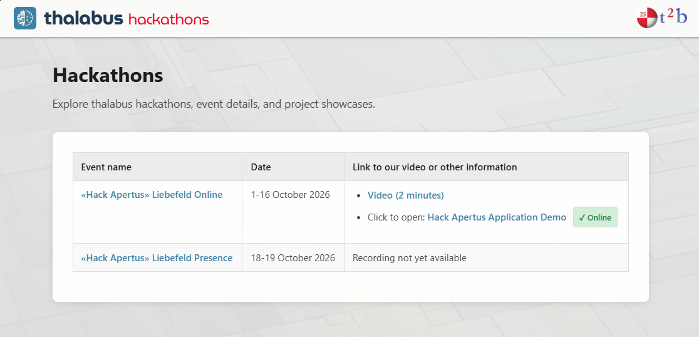

# Thalabus | Hack Apertus Track 2B

A prototype for exploring parliamentary documents: ingest them, categorise them against an ontology, extract a knowledge graph, and ask questions answered with citations. Proposals and applied changes are kept apart, and every answer cites the fragments it used.

Workspaces: **Documents** (ingest, status), **Categories** (propose, apply, extend the ontology), **Knowledge** (metamodel, graph extraction), **Graph** (explore entities), **Chat** (questions with citations).

**Built to run on your own hardware.** This application and the Thalabus platform it builds on are designed for local, on-premise installations in small data centres: no hyperscaler and no frontier LLM. Documents, the graph and inference stay on infrastructure you administer, using an open model of the Apertus class that fits on a single machine. Plan Local below is that design; Plan SaaS is only a development convenience.

## Very quick start

Want to see the prototype working on real data without setting anything up? Skip the clone, the `.env`, the `make run`, and the potentially 24-hour human-supervised ingestion, categorisation and graph-extraction run described below, and simply visit:

**<https://doc.thalabus.ai/hackathons>**

There, press the **Online** badge next to *Hack Apertus Application Demo* to open a hosted instance with the sample corpus already ingested, categorised and extracted.

<div align="center">

[](https://doc.thalabus.ai/hackathons)

*<https://doc.thalabus.ai/hackathons>*

</div>

This is a demonstration environment with our data, not yours. Everything below still applies when you want the stack running on hardware you control.

## `make run`

Needs Docker Engine with Compose v2, GNU Make, and an OpenAI-compatible chat endpoint (built for the Apertus family). The app is served at <http://localhost:8000>.

1. Copy `.env.example` to `.env` and set `LLM_API_KEY` (and `NEO4J_PASSWORD` for Plan Local). Never commit `.env`.
2. Start a run plan below.
3. Open the app and press **Test model — Hello World** before relying on the model.

### Plan Local (submitted path)

```sh
make run
```

Runs the app, its Neo4j, the Thalabus platform, and embedding and reranking services on your own host; inference stays inside the stack. Requires Linux ARM64, at least 128 GB RAM and an NVIDIA GPU with at least 96 GB memory (tested on NVIDIA DGX Spark); a preflight check refuses other hosts. `models-cache/` must hold the embedding and reranker weights.

### Plan SaaS (development fallback)

```sh
make run PLAN=SaaS
```

Runs the app locally against a remote Thalabus instance and model endpoints. Needs network access, credentials, and access agreed with T2B; it is not air-gapped. The checked-in profile is a laptop development profile: change the endpoint literals in `docker-compose.plan-saas.yml` to target another instance, and keep credentials out of committed files.

## Configuration

Secrets live only in `.env` (see `.env.example`); endpoints and models are literals in the compose files. The chat model is set by `LLM_NAME`, `LLM_BASE_URL` and `LLM_API_KEY` and can differ from the platform's own model, so confirm the resolved model in the app before attributing results to Apertus.

## Data

`data/sample/` holds 39 sample PDFs (about 19 MB). Their source and redistribution licence are **not yet recorded per file**; verify them before publishing. The template caps `data/` at 100 MB. A missing document or event means "not found in this snapshot", never proof that no answer exists.

## Verification

```sh
make health   # app and platform status
make lint     # release gate: image digests, nothing vendored
make verify   # documentation-versus-code checks (live checks need a running app)
python tests/categorization_unit_test.py
python tests/category_extension_unit_test.py
python tests/document_identity_unit_test.py
python tests/chat_expansion_unit_test.py
```

Passing unit tests do not show that a clean machine can run the full stack. Measurements and limits are in [`technical_report.md`](technical_report.md); per-feature notes are in [`docs/`](docs/).

## Submission status

This is the staging project, not the Thalabus monorepo. The public repository must contain only the approved submission tree, with no staging history, unrelated Thalabus source, credentials or private data, plus a root `PROVENANCE.md` (ownership, licence boundaries, access preconditions). 

## License

The CEO of T2B AG has released the right to copy and adapt the T2B-owned software part of Thalabus for this hackathon as open source; see the [release attestation](thalabus_opensource_release.pdf). The template is Apache-2.0. Component licences and data provenance are still to be settled at packaging. This repository grants no access to a Thalabus instance.
