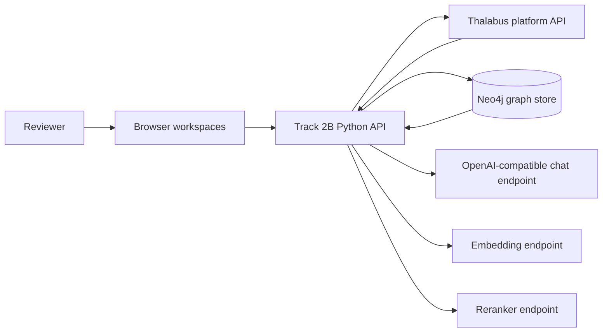

# Thalabus: Evidence-linked reasoning over parliamentary documents

- **Track:** Hack Apertus, Track 2B
- **Event format:** Online
- **Team:** `thalabus` — Luca Strozzi
- **Demo:** Two-minute recorded workflow; final recording link to be supplied with the submission
- **Report snapshot:** 2026-10-16

## 1. Summary

Parliamentary records are published as separate documents even when they concern the same
affair. Finding an answer can require locating the original question, later committee or
council material, and a response, while avoiding documents that merely share a person,
institution, or topic. Thalabus Track 2B is a browser-based prototype that makes this path
inspectable: documents are ingested into a graph-backed workflow, classified against a
constrained parliamentary ontology, optionally expanded through graph evidence, and queried
with citations to retrieved text.

The main contribution is not a claim of autonomous legal reasoning. The design premise is that
this application and the Thalabus platform beneath it are built for local, on-premise
installations in small data centres: no hyperscaler and no frontier LLM, with documents, graph
and inference kept on infrastructure the operator administers. The application is an auditable
workflow with visible proposal-versus-assignment state, document-level provenance, explicit
rejection reasons, and a simple/advanced retrieval comparison. In the live development graph,
re-categorising two Capaul-affair records moved `docid-411` from zero to 11 assigned
categories and `docid-394` from 13 to 17. The nine-document case cluster now has eight
categorised documents; `docid-413` remains the deliberate zero-category boundary. These are
snapshot observations, not an accuracy benchmark. Advanced chat evaluation and a fresh
knowledge-graph extraction of the cluster were still outstanding at this report snapshot.

## 2. Architecture

The same Python application can run in two configurations. Both the application and the
platform are conceived for small, locally administered data centres, which is why the
submitted target is **Plan Local** and why an open model that fits one machine is used instead
of a frontier-scale service. In that design, Docker Compose runs the application, Neo4j, the
Thalabus platform, embeddings, and
reranking services on infrastructure administered by the deploying organisation. The app
connects to the platform through its API and keeps its own graph store separate from the
platform database. Plan SaaS is a development and fallback profile: it runs the app locally
and reaches a configured platform and model endpoints over the network. The live measurements
in this report were taken with that development profile against the shared development graph,
so they do not demonstrate the on-premise property; they are not a clean Plan Local
installation.



The workspaces cover document ingestion, ontology inspection and category inference,
assignment and extension approval, knowledge-graph extraction, graph exploration, and
question answering. Category inference stores proposals on the document; only an explicit
categorisation action creates `HAS_CATEGORY`/`OF_CATEGORY` assignments and promotes the
document. Proposed ontology definitions are marked `proposed` and excluded from inference
until approved.

Chat simple mode embeds the question, searches document chunks, reranks candidates, applies a
relevance threshold, and generates an answer from retained fragments with citations. Advanced
mode adds category-affinity and shared-entity candidate discovery, checks entity bridges
against both current document texts, and asks the chat model to judge each surviving document
pair. Confirmed `RELATES` edges retain method, evidence, model, and seed provenance; rejected
pairs are returned to the UI without an edge. Both modes preserve citations and surface
degradation notes.

### Target architecture and dependencies

The selected target is **on-premise**. Plan Local co-locates the application, graph database,
platform services, and retrieval models on the organisation's own Docker host. It is designed
to keep document processing and graph storage under that operator's control. This report does
not claim sovereign-Swiss-cloud deployment or a verified air-gap: those require separate
hosting and network evidence. Plan Local's release gate is still open because the two
platform-image mirror digests and the platform owner's pull-and-run authorization are pending.

Plan Local's documented tested hardware class is Linux ARM64, NVIDIA DGX Spark/GB10, 128 GB
unified system memory, and at least 96 GB GPU memory. Its preflight enforces the hardware
requirements. Other architectures are not validated. Docker/Compose, image availability,
model weights, and the generated platform JWT keys are setup dependencies. At runtime the
local plan uses the chat endpoint configured for the platform and in-network embedding and
reranking services; the SaaS plan additionally requires network access, credentials, and an
authorized Thalabus instance. No credentials are included in this report.

## 3. Use of Apertus

The Thalabus platform model configuration in the SaaS profile is
`onprem-ai/Apertus-v1.5-70B-FP8`. The platform serves chat completions through its
OpenAI-compatible endpoint. Track 2B app-side operations use the same API shape but read an
independent model setting: the checked-in SaaS Compose default is `qwen-3.5-35b`, while its
platform model card is configured for Apertus. Therefore the repo configuration alone does not
prove that every Track 2B categorisation, extraction, pair-judging, or answer call ran on
Apertus. The final demo/evaluation record must capture the resolved app model and show the
Apertus route for any results claimed as Apertus-produced.

Prompts are application-owned; no fine-tuning, LoRA adapter, or quantisation step is performed
by this project. The platform model is configured as FP8 by its model identifier. The local
retrieval stack uses `Qwen/Qwen3-Embedding-0.6B` for embeddings and
`BAAI/bge-reranker-v2-m3` for cross-encoder reranking; those are retrieval models, not
substitutes for the Apertus chat model. Model weights and serving images are external build or
deployment artefacts and are not vendored into the application source.

## 4. Data

The application repository tracks 39 hash-named sample PDFs in `data/sample/` (about 18.9 MB).
The live development evaluation also used the Thalabus platform's `hackathon-temp` dossier,
which contained 40 document nodes at the measured snapshot. The report's case study is the
Schaffhausen parliamentary inquiry *Kleine Anfrage 20 24 / 2 6*, represented by nine linked
documents (`docid-389`, `391`, `394`, `402`, `405`, `410`, `411`, `413`, `414`). The files
are source documents, not human-subject study data; they may contain names and other personal
information appearing in public records. No human-subject recruitment or consent process was
part of this work.

The repository does not currently contain a per-file source and redistribution-licence
manifest for the PDFs. Their presence in the staging checkout is not evidence of permission
to redistribute them. Before creating the public package, verify each source and licence,
remove any material without a clear redistribution basis, and record the remaining provenance
in `PROVENANCE.md`. The same release review must reconcile the Apache-2.0 template licence,
the T2B open-source release attestation, and the still-unselected licence for the copied
platform source slice. This report does not assert that these distinct components share one
licence.

## 5. Evaluation

Evaluation was a mix of offline contract tests and a read-only inspection of the shared
development graph. There was no held-out question set, labelled relevance set, answer-accuracy
scoring, or controlled latency comparison. Consequently the results below establish exercised
behaviour and observed state, not general retrieval quality.

| Setup | Metric | Result |
|---|---|---|
| Simple RAG baseline | Quantitative answer quality / latency | Not benchmarked against a labelled test set |
| Advanced retrieval | Live end-to-end answer quality and expansion latency | Pending; the implementation and offline gate tests pass, but no post-change live comparison is claimed |
| Category inference and application | Live case-state change | `docid-411`: 0 → 11 categories; `docid-394`: 13 → 17; both status values became `Ready` |
| Document identity | Offline unit tests | 6/6 passed, including platform-node reuse and refusal to adopt a foreign node |
| Categorisation | Offline unit tests | 11/11 passed |
| Ontology extension | Offline unit tests | 9/9 passed; proposed definitions stay out of inference until approval |
| Advanced expansion | Offline fake-store tests | 0 failures; includes category ladder, co-mention gate, pair-judge verdicts, provenance, cache, and degradation paths |

At the post-T1 snapshot, eight of the nine case documents had assigned categories. Counts
were: `389` 11, `391` 10, `394` 17, `402` 10, `405` 11, `410` 10, `411` 11, `413` 0,
and `414` 6. Across these records, entity counts ranged from 0 (`405`) to 60 (`410`).
The `Parlament` ontology read on 2026-10-16 contained 49 definitions (27 approved and 22
proposed); proposed definitions had zero assignments, preserving the approval gate. These
counts are from the shared graph and its dated ontology query, and must not be generalized to a
clean deployment. Category assignment counts in this report are the later post-T1 document
snapshot and are listed separately above.

The case exposed two concrete risks. First, `docid-413` remains uncategorised, so a category
ladder cannot discover it. Second, the extracted entities on the rewritten `docid-394` text
were stale at the measurement point. A fresh extraction of the eight-document target set and
the live advanced-chat trace were still in progress; no claim that the full case trajectory
was successfully reconstructed is made here.

## 6. Limitations

- The current case cluster has an over-merged affair entity: the same affair node is claimed by
  documents that belong to different inquiries. A shared entity or category is a candidate
  signal, not proof of identity; the pair judge can also be wrong.
- Typed entity-to-entity extraction and cross-document event resolution are incomplete. The
  advanced mode uses candidate generation and an LLM pair check as a bounded substitute, not a
  validated legal-linking model.
- Text can change after extraction. Existing entity edges are not automatically proof that
  they describe the current text; the cluster must be re-extracted after a rewrite.
- Categories are ontology-constrained but may still be legitimate values applied to the wrong
  document. Proposed definitions are not classifications and require explicit approval.
- No statistical accuracy, calibration, demographic fairness, or multilingual quality study
  has been performed. No response-time result for live advanced mode is reported.
- Plan Local has not been established as a clean, reproducible release in this report; image
  digests, authorization, complete test deployment, and the release licensing/data audit
  remain gates. The shared development graph is mutable and contains unrelated corpora.

## 7. Reproducibility

The source baseline inspected for this report is commit
`dd9dcf37b1fcd7c261a1968d292f17deba4b0fde` in the Track 2B checkout. The focused offline
tests were run on Windows from that checkout with its Python environment; no random seed is
used by those contract tests. Live graph numbers are a dated shared-database snapshot, not a
fixture that a clean checkout recreates automatically.

For the documented local path, use Linux ARM64 on the tested DGX Spark hardware class, prepare
the model cache and JWT key pair, configure secrets in an untracked `.env`, then run:

```sh
make keys
make run
make health
```

To exercise the development fallback, use `make run PLAN=SaaS` with authorized endpoint
credentials and a reachable Thalabus instance. Do not use that profile as evidence of an
on-premise or air-gapped deployment. A clean release rehearsal must also pass `make lint`,
`make verify`, the offline tests above, a fresh extraction and chat trace, and a source/data
provenance review. The exact model IDs, image digests, hardware, data snapshot, and test output
should accompany that final rehearsal.

## 8. Next steps

1. Complete the eight-document extraction and capture the live advanced-mode question, answer,
  citations, pair decisions, and elapsed time; compare against simple mode on a small labelled
  set of questions.
2. Improve affair identity resolution and prevent stale extraction links after document text
  changes; add regression cases for over-merged and uncategorised documents.
3. Finish the Plan Local image-digest, authorization, hardware, and clean-install gates; test
  with outbound traffic disabled if an air-gap claim is desired.
4. Complete per-document data provenance, component licensing, and public-package secret scans
  before publishing the repository or its sample corpus.

## Licence and release status

This is a technical report for the staging checkout, not a licence grant. The template carries
Apache-2.0, while copied T2B platform code and the sample documents have separate provenance
and licensing questions. The final public package must include a reviewed `PROVENANCE.md` and
the applicable licence decisions; until then, do not interpret this report or the staging
repository as permission to redistribute platform code, private data, or hosted-service access.
